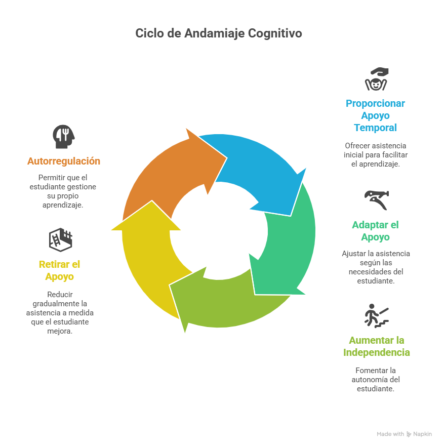

  <h1>👋 ¡Hola! Soy Camilo, Analista de Datos y Desarrollador Web.</h1>

<table>
  <tr>
    <td valign="top" width="65%">
      <h3>👨‍💻 Acerca de Mí</h3>
      

        Soy un <b>Analista de Datos y Desarrollador Web</b> apasionado por transformar la información en decisiones estratégicas. Mi carrera profesional, que comenzó con roles de auditoría y monitoreo de calidad en empresas como <b>Mercado Libre | Quality Monitor</b>, me ha proporcionado una sólida base en el manejo y la depuración de grandes volúmenes de datos, garantizando siempre su integridad mediante muestreo estadístico y control riguroso.
      

      

        Mi trayectoria me ha permitido no solo identificar y reportar sobre métricas clave, sino también optimizar procesos mediante el desarrollo de automatizaciones como scripts y macros. Esta experiencia práctica fue el catalizador que despertó mi interés por profundizar en la ciencia de datos.
      

      

        Ahora, como estudiante de <b>Ingeniería de Sistemas</b> y con formación continua en <b>Platzi, Coursera y Google Cloud</b>, mi objetivo es fusionar mi capacidad analítica con el desarrollo web para construir soluciones intuitivas que permitan una toma de decisiones más ágil y acertada.
      

    </td>
    <td valign="top" width="35%">
      <h3>🛠️ Habilidades</h3>
      

        
        
        
        
        
        
        
        
        
        
        
        
        
        
        
      

    </td>
  </tr>
</table>

---

  <h2>🧠 Mi Filosofía de Aprendizaje: Cognitive Scaffolding</h2>

  Creo firmemente en el aprendizaje estructurado y práctico. Este es el método que apliqué para construir mi portafolio y que guía mi desarrollo profesional.

  
Clic para ver las 5 reglas clave

  <ol>
    <li><b>El Punto de Partida: La Curiosidad y una Base Sólida.</b> No necesitas ser un experto para empezar, pero sí tener un conocimiento fundamental y el deseo de aprender. El andamio no puede sostenerse en el aire; se apoya en lo que ya sabes.</li>
    <li><b>El Motor: Un Proyecto Real como Norte.</b> Aprender en abstracto es difícil. Construir un proyecto real te da un "porqué" claro. Cada nueva tecnología que aprendía tenía un propósito inmediato.</li>
    <li><b>El Aprendizaje Activo: Preguntar Desde la Acción.</b> En lugar de preguntar "¿cómo se hace X?", la pregunta se transforma en "hice X, me encontré con este error, ¿cómo lo soluciono?". El aprendizaje ocurre al resolver problemas reales.</li>
    <li><b>El Andamio: Apalancarse en un Guía.</b> Nadie construye un rascacielos solo. Un "andamio" es crucial: un mentor, un curso o, en mi caso, una IA como guía estratégica. Es aprendizaje apalancado, no copiado.</li>
    <li><b>El Crecimiento Iterativo: De lo Básico a lo Complejo.</b> El proyecto se dividió en módulos, y cada uno aumentó el nivel de tecnicismo, desde la estructura básica y el estilo hasta el backend y el despliegue.</li>
  </ol>

---

## Integración de formulario con Google Sheets

Se agregó un endpoint en `src/app/api/contact/route.ts` para enviar los datos del formulario a la hoja de cálculo de Google Sheets.

### Qué hace
- Valida los campos `name`, `email` y `message`.
- Garantiza que la hoja `BD` tenga los encabezados:
  - `ID`
  - `Nombre`
  - `Email`
  - `Mensaje`
  - `Fecha`
- Inserta una fila nueva con un `ID` único generado por el servidor.

### Variables de entorno necesarias
Define estas variables en tu entorno o en Vercel:

- `GOOGLE_SHEETS_SPREADSHEET_ID`: valor real de la hoja de cálculo
- `GOOGLE_SHEETS_TAB_NAME`: `BD`
- `GOOGLE_SERVICE_ACCOUNT_EMAIL`: correo de la cuenta de servicio
- `GOOGLE_SERVICE_ACCOUNT_PRIVATE_KEY`: clave privada de la cuenta de servicio en formato JSON/PEM

### Preparar la hoja de cálculo
- Comparte la hoja con la cuenta de servicio.
- La aplicación agrega los encabezados automáticamente si no existen.

### Dependencias nuevas
- `googleapis`

### Envío del formulario
El formulario usa ahora `POST /api/contact` en lugar de un script externo.

---

---

  <h3>✨ Mi Proceso Visualizado ✨</h3>
  
<i></i>

  

---

<table>
  <tr>
    <td valign="top" width="50%">
      <h3>🤝 Conecta Conmigo</h3>
      

        
        
      

    </td>
    <td valign="top" width="50%">
      <h3>🚀 Próximamente</h3>
      

        ¡Nuevos proyectos y artículos en camino! Siempre buscando el siguiente desafío.
      

    </td>
  </tr>
</table>
